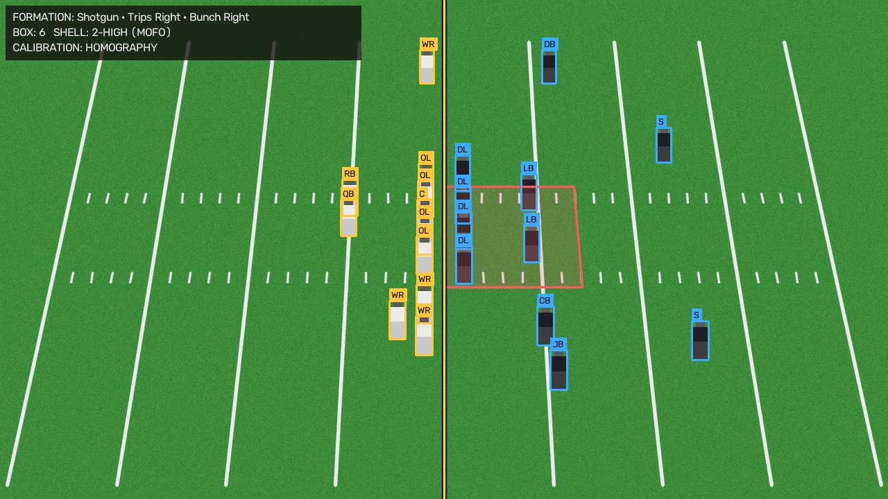
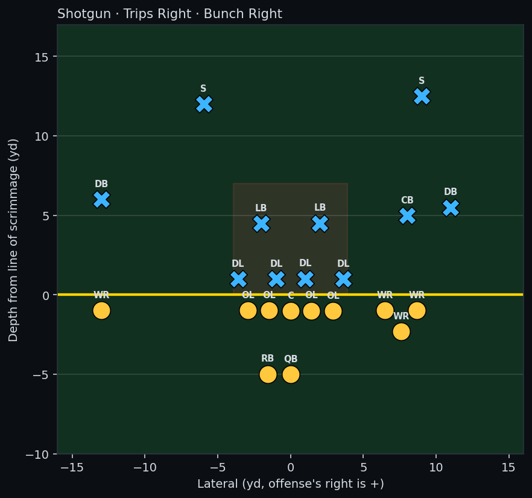
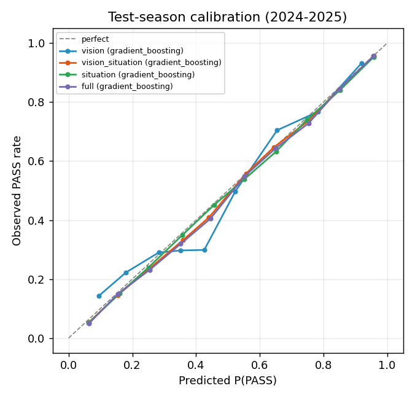

# NFL Defensive Intelligence

Analyses NFL broadcast footage from a defensive coordinator's point of view:
it tracks every player, finds the moment the offense is set before the snap,
registers the camera image to the field in yards, reads the offensive
formation and defensive alignment, and estimates the probability of a RUN or
a PASS with a model trained on nine seasons of NFL play-by-play data.

The system says `UNKNOWN` when broadcast footage does not support a call, and
it never fills in missing inputs for the model.

```
video ─► YOLO11 + ByteTrack ─► camera-stabilised motion ─► pre-snap windows
                                                              │
        jersey-colour teams ◄─ field registration (yards) ◄───┘
                │
                ▼
  line of scrimmage ─► roles (OL/QB/RB/WR/TE · DL/LB/CB/S) ─► formation + box + shell
                                                              │
                     nflverse-trained model (2016-23) ◄───────┘ (+ optional scoreboard)
                                │
                          P(RUN) / P(PASS)
```

<p align="center">
  
  
</p>
<p align="center"><sub>Synthetic broadcast-style frame with known ground truth (no NFL footage): registered field,
line of scrimmage, roles, box and safety shell, and the same read as a top-down diagram in yards.
Regenerate with <code>python scripts/make_readme_images.py</code>.</sub></p>

## What it does

| Stage | Implementation |
|---|---|
| Player tracking | YOLO11n + ByteTrack. Field-context and uniform evidence reject the crowd, staff and referees. A temporal UNKNOWN → CANDIDATE → ESTABLISHED state machine assigns Raiders/Broncos/REF labels on the original clip. |
| Camera stabilisation | Sparse optical flow on turf only (players masked out), RANSAC homography to a shot-local reference, and shot-change detection. |
| Pre-snap detection | Foot-point motion over 0.5 s, after removing a robust pan/zoom/roll similarity transform, in body-heights per second. A short-baseline burst detector locates the snap. |
| Field registration | Hough segments → RANSAC vanishing-point line families → 5-yard spacing check → 1D projective downfield map. Hash rows must show 1-yard regularity and must not run beside the solid sideline. Yard lines × hash rows give an image→field **homography in yards**. |
| Teams | Per-frame k-means on turf-free torso descriptors (fraction bright/dark, Lab chroma). Works for any matchup; officials are removed by stripe texture. |
| Formation | Line of scrimmage, offense identification (tight interior line vs. deep safeties), OL/QB/backs/receivers. Reports QB alignment (**Shotgun / Pistol / Under Center**), backfield (**Singleback / I-Formation / Empty**), receiver distribution, **Trips / Bunch**. Labels coexist, e.g. `Shotgun · Trips Right · Bunch Right`. |
| Defense | **Box count**, front (on-line / second level / secondary), approximate structure, and pre-snap **safety shell** (alignment only, not coverage). |
| Prediction | Logistic regression, random forest and gradient boosting against three baselines, split by season. Calibrated probabilities with a per-input sensitivity breakdown. |
| Dashboard | Streamlit, dark tactical theme. Video or screenshot input, overlay plus top-down diagram, probabilities, model status, play-by-play table, and a model lab with a what-if tool. |

## Results

### RUN/PASS model (real, held-out)

Data: [nflverse](https://github.com/nflverse/nflverse-data) play-by-play joined with participation data (formation, personnel, defenders in box).
- **Train** on 2016-2022.
- **Select** the model on 2023 (lowest validation log loss).
- **Report once** on 2024-2025: 69,110 plays, never used for fitting or selection.

Dropbacks (including sacks and scrambles) count as PASS. Only pre-snap fields are read, so outcome columns cannot leak in. Full tables, confusion matrices and permutation importance are in [`reports/ml_evaluation.md`](reports/ml_evaluation.md).

| Feature set (selected model) | Test accuracy | ROC AUC | Log loss | Brier | ECE |
|---|---|---|---|---|---|
| Always PASS (majority baseline) | 0.604 | 0.500 | 0.672 | 0.239 | 0.011 |
| Down & distance lookup (baseline) | 0.644 | 0.712 | 0.590 | 0.205 | 0.016 |
| QB-alignment lookup (baseline) | 0.761 | 0.745 | 0.547 | 0.181 | 0.022 |
| `vision`: QB alignment + box count (gradient boosting) | 0.760 | 0.782 | 0.533 | 0.177 | 0.034 |
| `situation`: down, distance, field position, clock, score (GB) | 0.715 | 0.795 | 0.524 | 0.178 | 0.009 |
| `qb_situation`: QB alignment + situation (GB) | 0.768 | 0.838 | 0.482 | 0.160 | 0.010 |
| `vision_situation`: vision + situation (GB) | 0.768 | 0.842 | 0.477 | 0.158 | 0.012 |
| `full`: + personnel counts (GB) | 0.769 | 0.843 | 0.476 | 0.158 | 0.015 |

What these numbers say:
- Shotgun vs. under center explains most of the signal. With vision features alone, the learned model **does not beat the QB-alignment lookup on accuracy**. It only improves ranking (AUC 0.745 → 0.782) and log loss.
- Situational context brings it to AUC ≈ 0.84.
- Personnel adds almost nothing on top of alignment, box count and situation.
- Calibration is good (ECE ≈ 0.01–0.03):

<p align="center"></p>

### Computer vision (measured on this machine, Apple M5, MPS)

- **Refactor regression.** The modular pipeline reproduces the original single-file `main.py` exactly: pixel-identical output frames over 240 frames on CPU, and identical label counts, camera statistics and movement metrics over the full 2,528-frame clip.
- **Tracking speed.** 28–33 fps at 1280×720 (yolo11n, 640 px input, MPS). A full 42 s clip analyses end to end in about 85 s: about 79 s of tracking plus about 5 s for formation analysis of the pre-snap windows.
- **Formation analysis, synthetic frames.** Broadcast-like renders with known ground truth (perspective camera, yard lines, hash marks, 22 players). QB alignment, backfield type, receiver distribution, trips/bunch, box count and safety shell are all correct for Shotgun 2x2, I-Formation, Singleback, Pistol, Trips/Bunch and Empty 3x2. Left/right stays correct when the field is mirrored. The homography error is 0.01 yd.
- **Formation analysis, sample broadcast clip.** Both genuine pre-snap moments are found and two false low-motion windows are rejected.
  - **Sideline view (2nd & 22).** Full homography calibration (0.06–0.17 yd RMS); the far sideline independently projects within about 9% of its true distance. The computed line of scrimmage lies on the broadcast's own blue LOS graphic. The read is **Shotgun** with a **2-high shell**, consistent across frames. The box count splits 3/4 between frames because two left-side linemen merge into one detection, so the system lowers its confidence and does not pass it to the model.
  - **End-zone view.** Yard lines are too sparse to calibrate. Most labels stay `UNKNOWN`; Shotgun is reported at reduced confidence.

  This is qualitative evidence on one clip, not an accuracy benchmark. There is no labelled broadcast dataset in this repository.

## Install

Tested with Python 3.9 on macOS (Apple Silicon, MPS) and on CPU.

```bash
python3 -m venv .venv && source .venv/bin/activate
pip install -r requirements.txt
```

`yolo11n.pt` downloads automatically on first use. Put a broadcast clip at `videos/RaidersBroncos.mp4` (or anywhere) for video features.

## Run

```bash
# 1. Train and evaluate the RUN/PASS models (~200 MB download, ~2.5 min on an M5)
python -m nfl_analytics.ml.train --download

# 2. Dashboard
streamlit run app/dashboard.py

# 3. End-to-end analysis from the command line (situation arguments are optional)
python -m nfl_analytics.integration.cli --input videos/RaidersBroncos.mp4 \
    --down 2 --distance 22 --quarter 2 --clock 10:48 --score-diff -7

# 4. Original annotated tracking video (unchanged CLI)
python main.py --input videos/RaidersBroncos.mp4 --output out.mp4 --device auto

# 5. Tests (the slow ones need the local clip and weights; they are skipped otherwise)
python -m pytest
```

### Demo walkthrough

1. Open the dashboard and pick **Sample clip** (or upload a video or a pre-snap screenshot).
2. Optionally enter the scoreboard situation. Blank fields stay missing.
3. Press **Analyze** and choose a pre-snap window. The **Pre-Snap Read** tab shows the registered field overlay (line of scrimmage, box, roles), a top-down diagram and every finding with its confidence and evidence.
4. **Play-Call Prediction** shows the RUN/PASS probabilities, the model used, its held-out metrics and what moved the estimate. If inputs are missing, it lists what each model still needs.
5. **Model Lab** works without video: held-out metrics, calibration plot and a what-if predictor.

## Architecture

```
main.py                         original tracking CLI (thin wrapper)
nfl_analytics/
  vision/       config, device (MPS/CUDA/CPU fallback), field, camera, classification,
                movement, render, pipeline (TrackingPipeline -> per-frame FrameAnalysis)
  formation/    field_registration (lines, hashes, homography), teams (colour clustering),
                analysis (LOS, roles, findings), analyzer (1920-px detection + consensus), render
  integration/  presnap (motion, windows, snap), video_analysis (orchestration), cli
  ml/           data (nflverse download/join), features (labels, pre-snap features),
                evaluate (metrics, calibration, baselines), train, predict
app/dashboard.py                Streamlit UI
tests/                          unit, synthetic end-to-end, regression and dashboard tests
reports/                        generated evaluation (committed); models/ and data/ are git-ignored
```

Design choices:
- **Calibrate the field, don't threshold pixels.** Depth and box rules use yards from a homography fitted to painted markings. Each output records its calibration tier (`HOMOGRAPHY`, `YARD_LINES` or `NONE`), and depth-dependent labels are withheld without calibration.
- **Fail loudly.** Every finding carries a confidence and a written reason. Only findings with confidence ≥ 0.5 become model inputs. The predictor picks the lowest-validation-loss model whose inputs are *all* present and otherwise reports what is missing.
- **Separate resolutions.** Tracking runs at 640 px for speed. Pre-snap frames are re-detected at 1920 px, which separates clumped linemen far better (6 vs. 4 boxes in the sample line).

## Known limitations

- **Detection in clumps.** yolo11n (a COCO person detector) merges linemen in stance, so 3–4 of 5 linemen is common. The analyzer compensates where geometry allows and otherwise lowers confidence or returns `UNKNOWN`. A detector fine-tuned on football would help most.
- **Camera angles.** Calibration needs a wide shot showing at least two yard lines, and both hash rows for full lateral calibration. End-zone and low sideline angles, close-ups and replays fall back to uncalibrated or `UNKNOWN`.
- **Offense identification** is heuristic. It can fail in tight goal-line looks or uncalibrated views; the dashboard and CLI let the user specify the offense.
- **Box definition.** This system's box (1 yd outside the end men on the line, 7 yd deep) approximates, but is not identical to, the charting definition behind nflverse `defenders_in_box`.
- **Not reported reliably:** coverage schemes, personnel groupings (TE vs. WR), jersey numbers, down and distance (no scoreboard OCR), field position from video.
- **League-wide tendencies.** Predictions do not account for team-specific behaviour.
- **Validation.** Vision accuracy has been measured on synthetic ground truth and inspected on one real clip only. A labelled set of broadcast pre-snap frames is needed for real accuracy figures.
- **Team names.** Raiders/Broncos names come from the original game-specific uniform classifier. For other games, teams are reported as light (A) and dark (B) jerseys.

## Future work

- Fine-tune a player/lineman detector and add jersey-number OCR (for personnel and motion tracking).
- Read down, distance and clock from the scorebug.
- Build a labelled benchmark from public pre-snap frames joined to play-by-play, to measure formation and box accuracy against charted data.
- Add team- and coordinator-specific tendency models, and pre-snap motion/shift features.
- Use full-sequence features (motion, shifts, play-clock timing) rather than a single pre-snap frame.

## Data, footage and licensing

- Play-by-play and participation data come from the public **nflverse-data** GitHub releases and are downloaded on demand into `data/raw/` (git-ignored); see nflverse for licence and attribution terms.
- No NFL footage, trained models, downloaded data or generated videos are committed (`.gitignore`). Bring your own clip.
